<p align="center">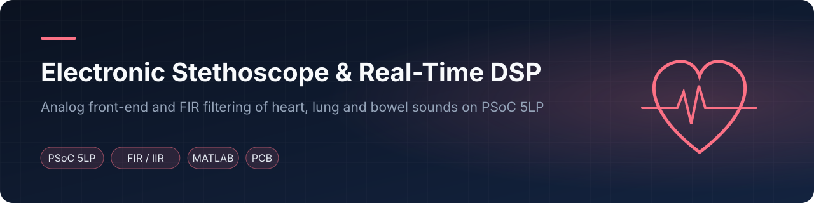</p>

<p align="center">     </p>
<p align="center"><a href="#english">English</a> · <a href="#español">Español</a></p>

## English

### Overview
A digital electronic stethoscope built on a PSoC 5LP. It is a redesign of an earlier, fully analog stethoscope ([PVDF front-end with fixed analog filtering](https://github.com/simplementeUnPorito/analog-electronics-pcb/tree/main/projects/02-analog-electronic-stethoscope)): here the signal from a CM-01B contact microphone is digitized at 8 kHz, filtered in real time by a user-selectable linear-phase FIR filter for heart, lung or bowel sounds, and reconstructed for a speaker. Filter design was done in MATLAB/Simulink and the full chain was measured on a breadboard with an oscilloscope.

<p align="center">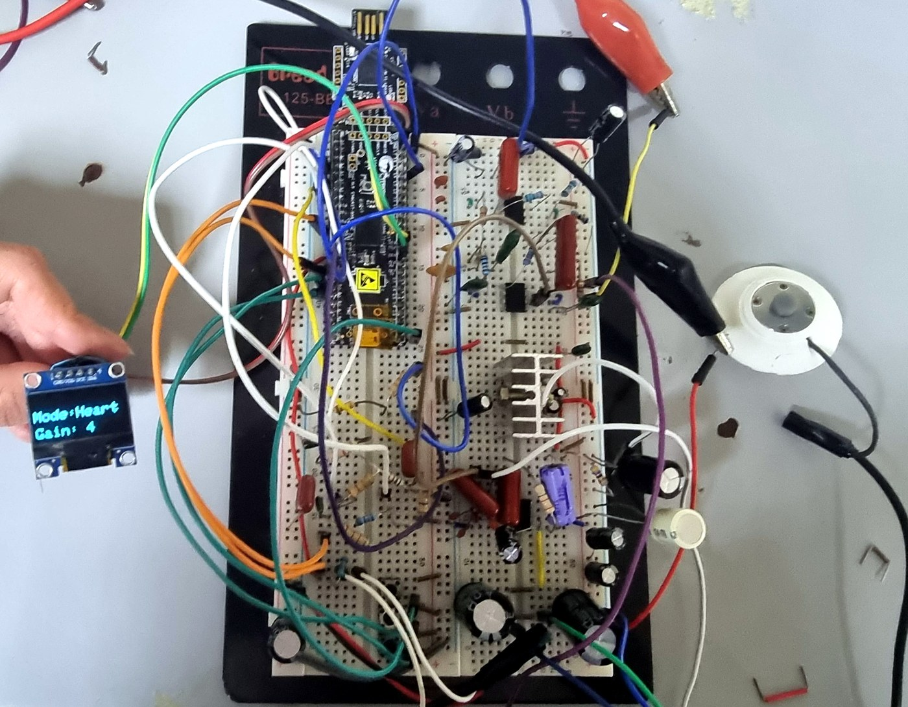<br><sub>Breadboard prototype: PSoC 5LP, analog chain, OLED mode display and contact sensor.</sub></p>

### Highlights
- Frequency bands of interest: heart 20-450 Hz, lung 100-1000 Hz, bowel 8-300 Hz; sampling rate chosen at 8 kHz.
- 4th-order Bessel anti-alias filter (1.5 kHz pass frequency, linear phase), the minimum order that attenuates the CM-01B 5 kHz resonance (20 dB peak) in Simulink; the same Bessel design is reused as reconstruction filter.
- Delta-sigma ADC in continuous mode (17 bits at 8 kHz, reduced to 16 bits for a 0.064 V range), two cascaded PGAs, DMA into the PSoC Filter block and a 12-bit DAC with saturation at 0xFF0.
- Linear-phase FIR filters (Kaiser window, beta = 8) chosen over IIR, Parks-McClellan and least-squares to avoid phase distortion and passband ripple; coefficients swapped at run time through the Filter block RAM.
- User interface: three debounced buttons (filter select, volume +/-) and an SSD1306 OLED showing mode and gain.
- Measured gain and phase of every mode (anti-alias to DAC and to the audio output) and oscilloscope captures of heart, lung and bowel signals.

### System architecture
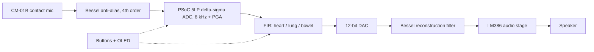
Compared with the analog version, the fixed analog filtering is replaced by three selectable digital filters and a gain control, and the band can be changed at run time.

### Hardware
| Component | Role |
|-----------|------|
| CM-01B contact microphone | Voltage-output sensor in the DSP chain (datasheet not redistributed) |
| PSoC 5LP | Delta-sigma ADC, PGAs, DMA, FIR Filter block, 12-bit DAC, button/OLED interface |
| TL072 (OPA2337 tested), LM7805 | Reconstruction filter; 12 V supply with 5 V regulator |
| LM386, woofer with Zobel network | Audio output stage |
| SSD1306 OLED, 3 push buttons | Mode and volume interface |
| Oscilloscope, function generator | Measurement |

### Repository layout
```
stethoscope/
  dsp/                MATLAB scripts, Simulink/Simscape models, FIR coefficient tables, sensor capsule STL
  interface/          Button/debouncer circuit and UI description
  docs/               Pointer to figures and measurements
studies/
  fir-vs-iir-bandpass-on-psoc/    Chebyshev IIR vs Parks-McClellan FIR on the Filter block
  realtime-iir-uart-validation/   Firmware IIR + MATLAB capture over UART
docs/img/             Figures; measurements/ and oscilloscope/ captures
```

### Getting started
- MATLAB R2023b or later with Signal Processing, DSP System, Control System and Simscape toolboxes for `stethoscope/dsp/`.
- PSoC Creator 4.x for the projects in `studies/` (the stethoscope firmware project itself was not recovered; see `stethoscope/dsp/README.md`).

### Results

**FIR filter bank (Kaiser window, 8 kHz)**
<table><tr>
<td align="center" width="33%"><br><sub>Heart band, 20–450 Hz</sub></td><td align="center" width="33%">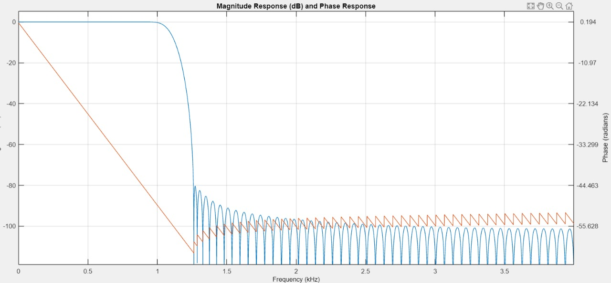<br><sub>Lung band, 100–1000 Hz</sub></td><td align="center" width="33%">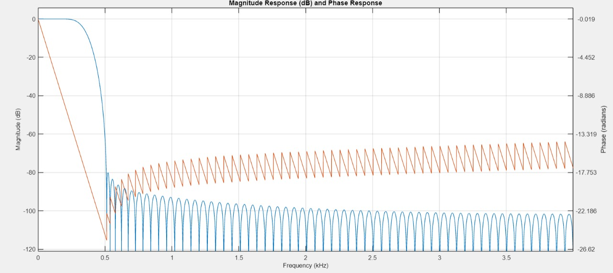<br><sub>Bowel band, 8–300 Hz</sub></td>
</tr></table>

**End-to-end measurements**
<table><tr>
<td align="center" width="33%"><br><sub>Three modes, ADC input to PSoC output</sub></td><td align="center" width="33%"><br><sub>Heart mode up to the reconstruction filter</sub></td><td align="center" width="33%"><br><sub>Heart sound: input (pink) vs filtered output (green)</sub></td>
</tr><tr>
<td align="center" width="33%">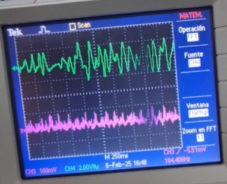<br><sub>Lung sound during inspiration</sub></td><td align="center" width="33%">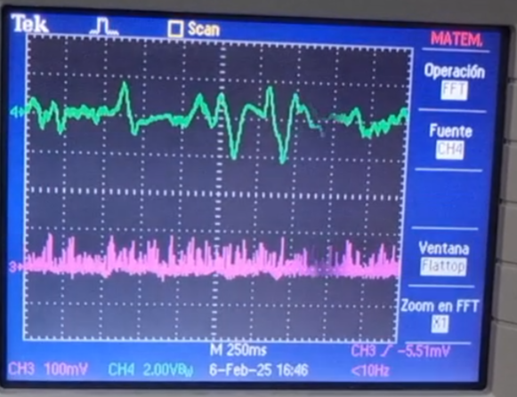<br><sub>Diaphragm while speaking</sub></td><td align="center" width="33%">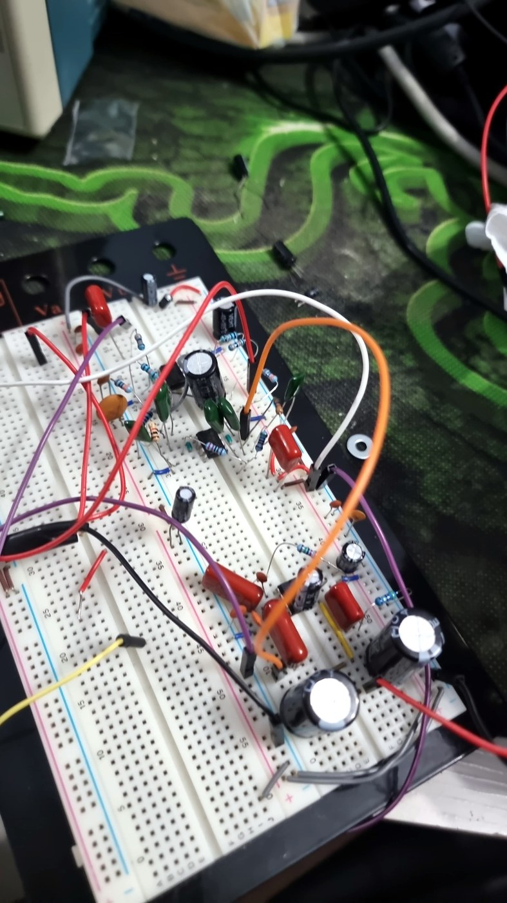<br><sub>Breadboard signal chain, close-up</sub></td>
</tr></table>

**Bench measurements**
<table><tr>
<td align="center" width="33%">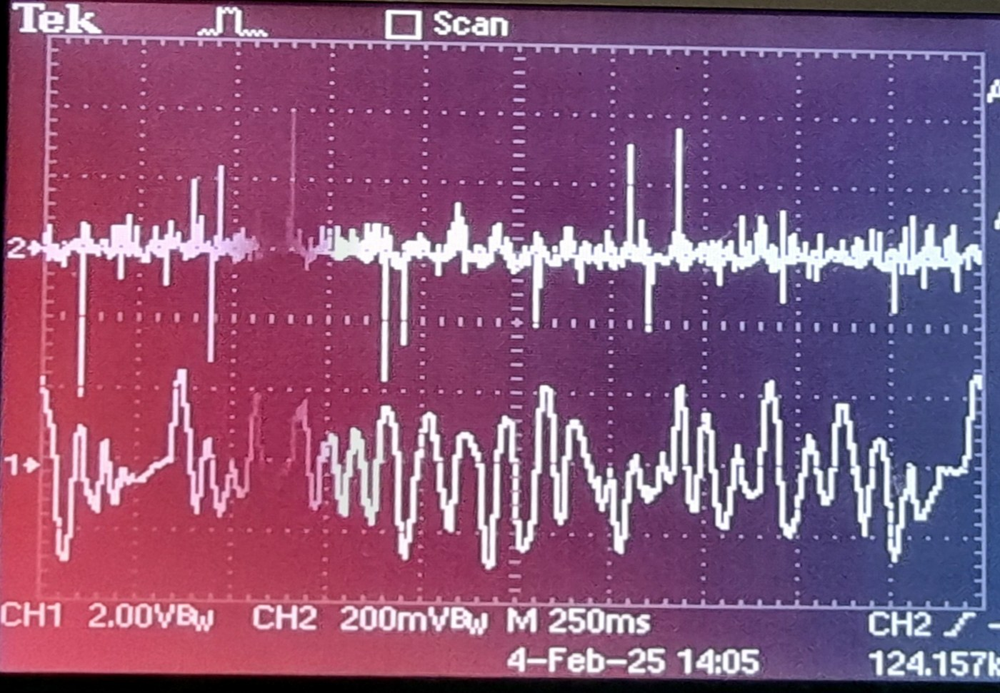<br><sub>Oscilloscope capture of heart-sound channels</sub></td><td align="center" width="33%">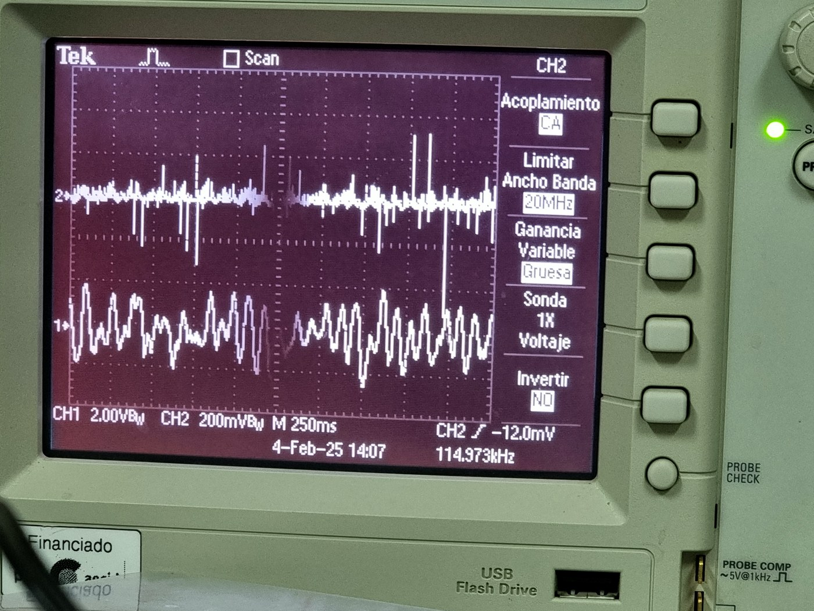<br><sub>Filtered signal and bursts on two channels</sub></td><td align="center" width="33%">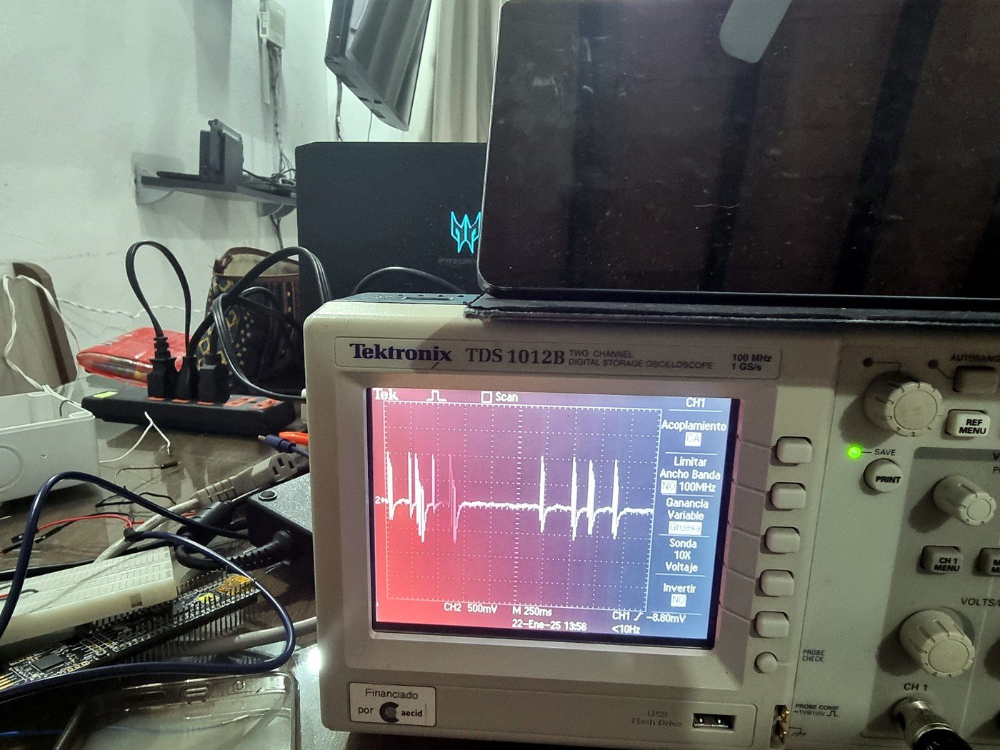<br><sub>Pulsed waveform beside the breadboard</sub></td>
</tr></table>

More: measured gain and phase in [`docs/img/measurements/`](docs/img/measurements) and oscilloscope captures in [`docs/img/oscilloscope/`](docs/img/oscilloscope). Studies: [FIR vs IIR](studies/fir-vs-iir-bandpass-on-psoc/README.md), [IIR over UART](studies/realtime-iir-uart-validation/README.md).

Reported limitations: supply noise (solved with an independent supply), output ripple above the estimate, attenuation in the PSoC input buffer, and an LM386 that could not drive the woofer used as load; proposed fixes are a class-AB or dedicated power stage and better op-amps.

A PCB layout for the analog filter stage was started in EasyEDA but not routed; the work-in-progress project is kept in `hardware/easyeda/` for reference.

### Analog predecessor
The fully analog version of the stethoscope (PVDF sensor, charge amplifier, INA128, fabricated PCB) is a separate project: [analog-electronics-pcb / analog electronic stethoscope](https://github.com/simplementeUnPorito/analog-electronics-pcb/tree/main/projects/02-analog-electronic-stethoscope).

### Team & credits
- Digital stethoscope (2025): developed by Elías Álvarez and Tania Romero at Universidad Católica "Nuestra Señora de la Asunción" (Paraguay).
- Studies in `studies/`: Elías David Álvarez Martínez and Tania Patricia Romero Centurión, 2024; advisor Lic. Federico Daniel Morán Fretes.

### License
MIT (see `LICENSE`). Figures are shared for reference. Third-party datasheets and code are linked, not redistributed.

## Español

### Descripción
Estetoscopio electrónico digital sobre PSoC 5LP. Es un rediseño de un estetoscopio anterior totalmente analógico ([front-end PVDF con filtrado analógico fijo](https://github.com/simplementeUnPorito/analog-electronics-pcb/tree/main/projects/02-analog-electronic-stethoscope)): acá la señal de un micrófono de contacto CM-01B se digitaliza a 8 kHz, se filtra en tiempo real con un FIR de fase lineal seleccionable (corazón, pulmón o intestino) y se reconstruye para un parlante. Los filtros se diseñaron en MATLAB/Simulink y la cadena completa se midió en protoboard con osciloscopio.

### Puntos destacados
- Bandas de interés: corazón 20-450 Hz, pulmón 100-1000 Hz, intestino 8-300 Hz; muestreo a 8 kHz.
- Anti-alias Bessel de 4.º orden (1,5 kHz), mínimo que atenúa la resonancia del CM-01B a 5 kHz (pico de 20 dB); el mismo diseño se usa en la reconstrucción.
- ADC delta-sigma continuo (17 bits a 8 kHz, reducido a 16 bits para un rango de 0,064 V), dos PGA en cascada, DMA hacia el bloque Filter y DAC de 12 bits con saturación en 0xFF0.
- FIR de fase lineal (ventana Kaiser, beta = 8) frente a IIR, Parks-McClellan y mínimos cuadrados; coeficientes intercambiados en ejecución.
- Interfaz: tres botones con antirrebote por hardware y pantalla OLED SSD1306.
- Mediciones de ganancia y fase por modo y capturas de osciloscopio de señales cardíacas, pulmonares e intestinales.

### Arquitectura, hardware y estructura
Ver el diagrama mermaid, la tabla y el árbol de la sección en inglés. `stethoscope/dsp/` los scripts, modelos y tablas de coeficientes; `stethoscope/interface/` la interfaz; `studies/` los dos estudios.

### Cómo empezar
MATLAB R2023b o superior (Señales, DSP, Control, Simscape); PSoC Creator 4.x para `studies/` (el proyecto de firmware del estetoscopio no se recuperó).

### Resultados
Ver las figuras de arriba, `docs/img/measurements/` y `docs/img/oscilloscope/`. Limitaciones informadas: ruido de fuente (resuelto con fuente independiente), ripple de salida mayor al estimado, atenuación en el buffer del PSoC y un LM386 que no pudo excitar el woofer usado como carga.

Se empezó un diseño de PCB para la etapa de filtros analógicos en EasyEDA, sin rutear; el proyecto en curso queda en `hardware/easyeda/` como referencia.

### Antecesor analógico
La versión totalmente analógica (sensor PVDF, amplificador de carga, INA128, PCB fabricada) es un proyecto aparte: [estetoscopio analógico](https://github.com/simplementeUnPorito/analog-electronics-pcb/tree/main/projects/02-analog-electronic-stethoscope).

### Equipo y créditos
- Estetoscopio digital (2025): Elías Álvarez y Tania Romero, Universidad Católica "Nuestra Señora de la Asunción" (Paraguay).
- Estudios: Elías David Álvarez Martínez y Tania Patricia Romero Centurión, 2024; tutor Lic. Federico Daniel Morán Fretes.

### Licencia
MIT (ver `LICENSE`). Las figuras se comparten como referencia.
