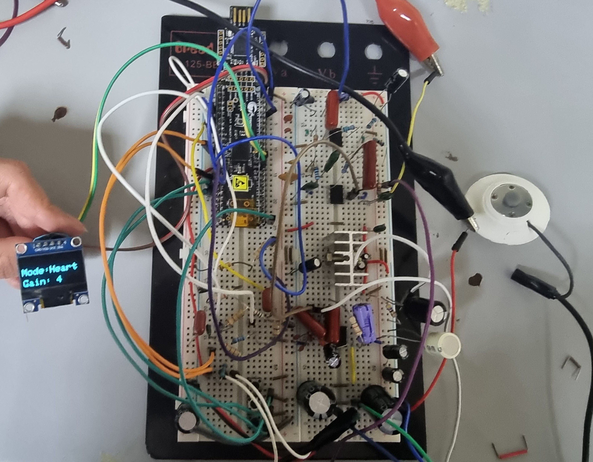
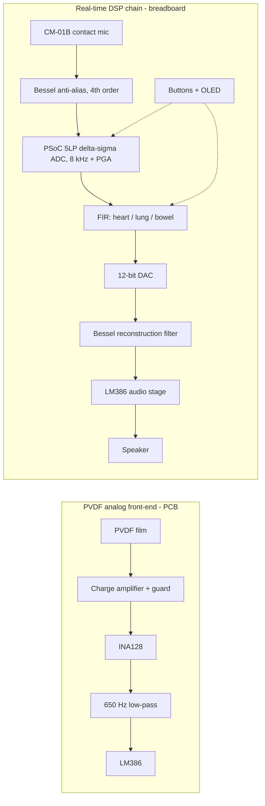
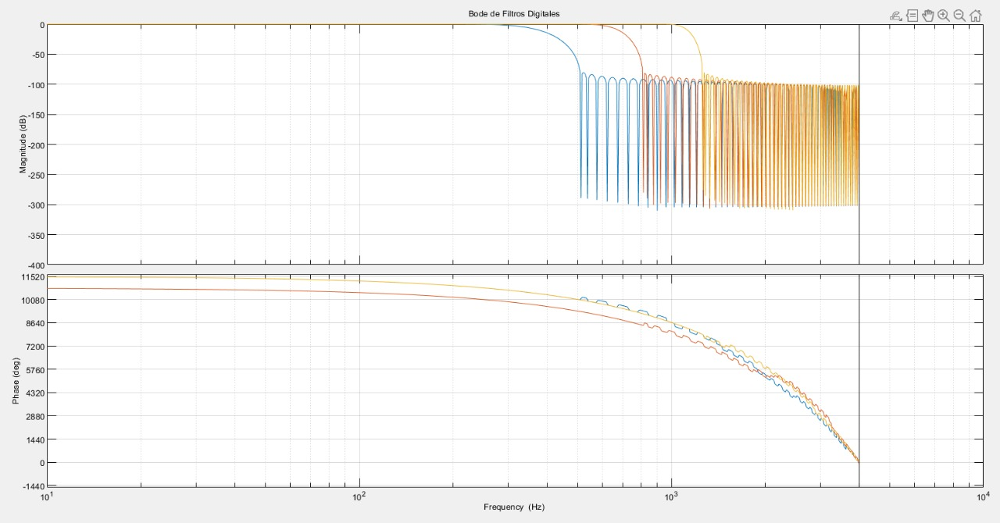
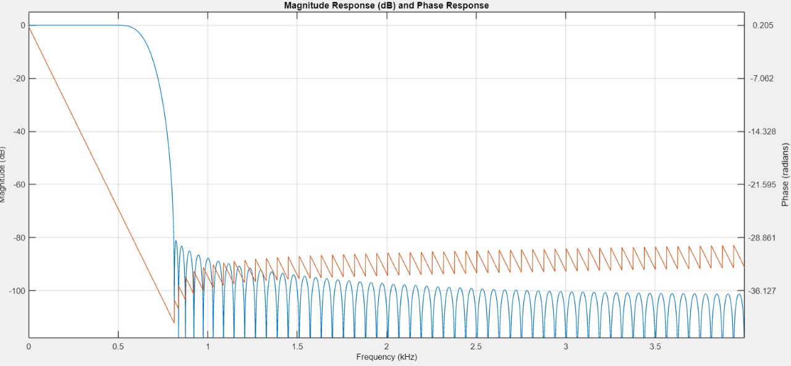
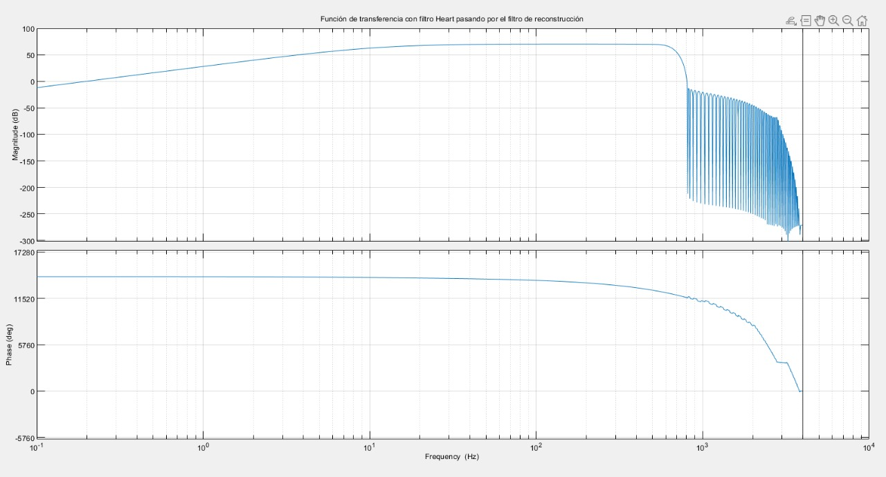
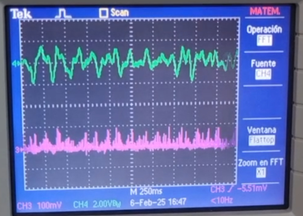
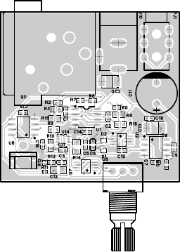
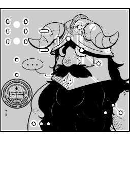

<p align="center"></p>
<h1 align="center">Electronic Stethoscope: PVDF Front-End and Real-Time DSP on PSoC 5LP</h1>
<p align="center"><b>Analog acquisition, selectable heart / lung / bowel FIR filtering on a PSoC 5LP, and an audio output stage, from simulation to breadboard measurements.</b><br>
     </p>
<p align="center"><a href="#english">English</a> · <a href="#español">Español</a></p>

## English

### Overview
Auscultation with an acoustic stethoscope offers little control over amplification and filtering. This project builds an electronic stethoscope in two stages: an analog front-end for a PVDF piezoelectric film sensor (charge amplifier, instrumentation amplifier, 650 Hz low-pass, LM386 audio stage; simulated in PSpice and fabricated as a PCB), and a real-time DSP system on the PSoC 5LP that digitizes the signal at 8 kHz, applies a user-selectable linear-phase FIR filter for heart, lung or bowel sounds, and reconstructs the audio for a speaker. In the DSP system the sensor is a CM-01B contact microphone with built-in conditioning, so the charge-amplifier stages of the PVDF front-end are not in that path. The filter chain was designed in MATLAB/Simulink and measured on a breadboard with an oscilloscope.

### Highlights
- Frequency bands of interest: heart 20-450 Hz, lung 100-1000 Hz, bowel 8-300 Hz; sampling rate chosen at 8 kHz.
- 4th-order Bessel anti-alias filter (1.5 kHz pass frequency, linear phase), the minimum order that attenuates the CM-01B 5 kHz resonance (20 dB peak) in Simulink; the same Bessel design is reused as reconstruction filter.
- Delta-sigma ADC in continuous mode (17 bits at 8 kHz, reduced to 16 bits for a 0.064 V range), two cascaded PGAs, DMA into the PSoC Filter block and a 12-bit DAC with saturation at 0xFF0.
- Linear-phase FIR filters (Kaiser window, beta = 8) chosen over IIR, Parks-McClellan and least-squares to avoid phase distortion and passband ripple; coefficients swapped at run time through the Filter block RAM.
- User interface: three debounced buttons (filter select, volume +/-) and an SSD1306 OLED showing mode and gain.
- PVDF analog front-end with differential charge amplifier, active guard, INA128 and two PCB layouts (the compact one manufactured).
- Measured gain and phase of every mode (anti-alias to DAC and to the audio output) and oscilloscope captures of heart, lung and bowel signals.

### System architecture

The PVDF front-end conditions a charge-output sensor with fixed analog filtering; the DSP chain replaces that filtering with selectable digital filters.

### Hardware
| Component | Role |
|-----------|------|
| PVDF piezo film, OPA338 / OPA350 / OPA337, INA128 | Analog front-end: charge amplifier, guard, reference, instrumentation amplifier |
| CM-01B contact microphone | Voltage-output sensor in the DSP chain (datasheet not redistributed) |
| PSoC 5LP | Delta-sigma ADC, PGAs, DMA, FIR Filter block, 12-bit DAC, button/OLED interface |
| TL072 (OPA2337 tested), LM7805 | Reconstruction filter; 12 V supply with 5 V regulator |
| LM386, woofer with Zobel network | Audio output stage |
| SSD1306 OLED, 3 push buttons | Mode and volume interface |
| Oscilloscope, function generator | Measurement |

### Repository layout
```
stethoscope/
  analog-front-end/   PVDF front-end: PCB exports, OrCAD simulation, stage schematics
  dsp/                MATLAB scripts, Simulink/Simscape models, FIR coefficient tables, sensor capsule STL
  interface/          Button/debouncer circuit and UI description
  docs/               Pointer to figures and measurements
studies/
  fir-vs-iir-bandpass-on-psoc/    Chebyshev IIR vs Parks-McClellan FIR on the Filter block
  realtime-iir-uart-validation/   Firmware IIR + MATLAB capture over UART
docs/img/             Figures; measurements/ and oscilloscope/ captures
```

### Getting started
- MATLAB R2023b or later with Signal Processing, DSP System, Control System and Simscape toolboxes for `stethoscope/dsp/`.
- PSoC Creator 4.x for the projects in `studies/` (the stethoscope firmware project itself was not recovered; see `stethoscope/dsp/README.md`).
- OrCAD Capture / PSpice (Cadence SPB 23.1) for `stethoscope/analog-front-end/simulation/`; TI vendor models must be added from the manufacturer.

### Results
| | |
|---|---|
|  |  |
| Magnitude and phase of the three implemented FIR filters, ADC input to PSoC output | Heart-mode FIR filter, magnitude and phase |
|  |  |
| Heart-mode transfer function up to the reconstruction filter | Heart signal, input (pink) and output (green) |
|  |  |
| Lung sound during inspiration | Diaphragm while speaking |

More: measured gain and phase in [`docs/img/measurements/`](docs/img/measurements) and oscilloscope captures in [`docs/img/oscilloscope/`](docs/img/oscilloscope). Analog front-end and its test outcome: [`stethoscope/analog-front-end/`](stethoscope/analog-front-end/README.md). Studies: [FIR vs IIR](studies/fir-vs-iir-bandpass-on-psoc/README.md), [IIR over UART](studies/realtime-iir-uart-validation/README.md).

Reported limitations: supply noise (solved with an independent supply), output ripple above the estimate, attenuation in the PSoC input buffer, and an LM386 that could not drive the woofer used as load; proposed fixes are a class-AB or dedicated power stage and better op-amps.

### PCB
The PVDF front-end was fabricated (compact layout); exports are in [`stethoscope/analog-front-end/hardware/pcb/`](stethoscope/analog-front-end/hardware/pcb/README.md). The DSP chain was built on a breadboard.

<p align="center"> </p>

### Team & credits
- Analog front-end (2024) and DSP system (2025): developed by Elías Álvarez and Tania Romero at Universidad Católica "Nuestra Señora de la Asunción" (Paraguay).
- Studies in `studies/`: Elías David Álvarez Martínez and Tania Patricia Romero Centurión, 2024; advisor Lic. Federico Daniel Morán Fretes.

### License
MIT (see `LICENSE`). Figures are shared for reference. Third-party datasheets and code are linked, not redistributed.

## Español

### Descripción
La auscultación con estetoscopio acústico ofrece poco control de amplificación y filtrado. Este proyecto construye un estetoscopio electrónico en dos etapas: un front-end analógico para un sensor piezoeléctrico de película PVDF (amplificador de carga, INA128, pasa-bajos de 650 Hz y etapa de audio LM386; simulado en PSpice y fabricado como PCB) y un sistema DSP en tiempo real sobre el PSoC 5LP que digitaliza a 8 kHz, aplica un filtro FIR de fase lineal seleccionable (corazón, pulmón o intestino) y reconstruye el audio para un parlante. En el sistema DSP el sensor es un micrófono de contacto CM-01B con acondicionamiento integrado, por lo que las etapas de carga del front-end PVDF no están en ese camino. La cadena se diseñó en MATLAB/Simulink y se midió en protoboard con osciloscopio.

### Puntos destacados
- Bandas de interés: corazón 20-450 Hz, pulmón 100-1000 Hz, intestino 8-300 Hz; muestreo a 8 kHz.
- Anti-alias Bessel de 4.º orden (1,5 kHz), mínimo que atenúa la resonancia del CM-01B a 5 kHz (pico de 20 dB); el mismo diseño se usa en la reconstrucción.
- ADC delta-sigma continuo (17 bits a 8 kHz, reducido a 16 bits para un rango de 0,064 V), dos PGA en cascada, DMA hacia el bloque Filter y DAC de 12 bits con saturación en 0xFF0.
- FIR de fase lineal (ventana Kaiser, beta = 8) frente a IIR, Parks-McClellan y mínimos cuadrados; coeficientes intercambiados en ejecución.
- Interfaz: tres botones con antirrebote por hardware y pantalla OLED SSD1306.
- Front-end PVDF con amplificador de carga diferencial, guarda activa, INA128 y dos diseños de PCB (se fabricó el compacto).
- Mediciones de ganancia y fase por modo y capturas de osciloscopio de señales cardíacas, pulmonares e intestinales.

### Arquitectura, hardware y estructura
Ver el diagrama mermaid, la tabla y el árbol de la sección en inglés. `stethoscope/analog-front-end/` contiene el front-end PVDF; `stethoscope/dsp/` los scripts, modelos y tablas de coeficientes; `stethoscope/interface/` la interfaz; `studies/` los dos estudios.

### Cómo empezar
MATLAB R2023b o superior (Señales, DSP, Control, Simscape); PSoC Creator 4.x para `studies/` (el proyecto de firmware del estetoscopio no se recuperó); OrCAD Capture/PSpice para la simulación analógica (modelos de TI aparte).

### Resultados
Ver las figuras de arriba, `docs/img/measurements/` y `docs/img/oscilloscope/`. Limitaciones informadas: ruido de fuente (resuelto con fuente independiente), ripple de salida mayor al estimado, atenuación en el buffer del PSoC y un LM386 que no pudo excitar el woofer usado como carga.

### PCB
El front-end PVDF se fabricó (diseño compacto); ver `stethoscope/analog-front-end/hardware/pcb/`. La cadena DSP se armó en protoboard.

### Equipo y créditos
- Front-end analógico (2024) y sistema DSP (2025): Elías Álvarez y Tania Romero, Universidad Católica "Nuestra Señora de la Asunción" (Paraguay).
- Estudios: Elías David Álvarez Martínez y Tania Patricia Romero Centurión, 2024; tutor Lic. Federico Daniel Morán Fretes.

### Licencia
MIT (ver `LICENSE`). Las figuras se comparten como referencia.
