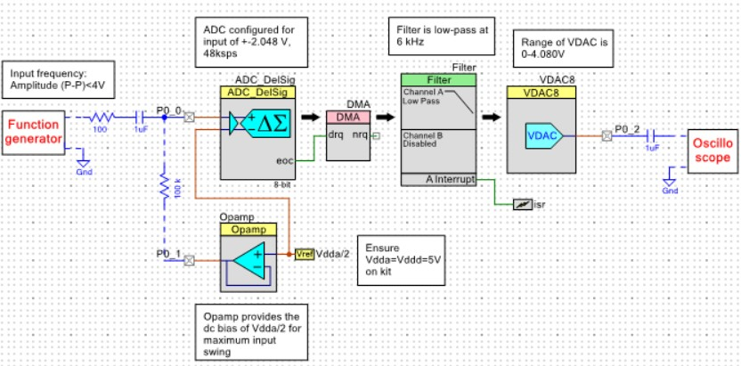
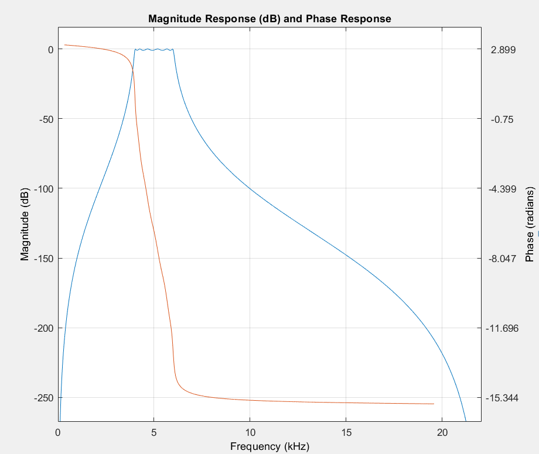
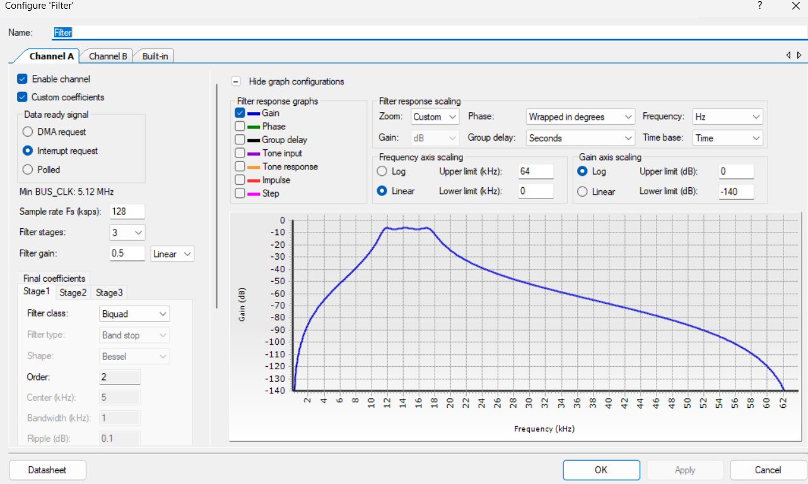
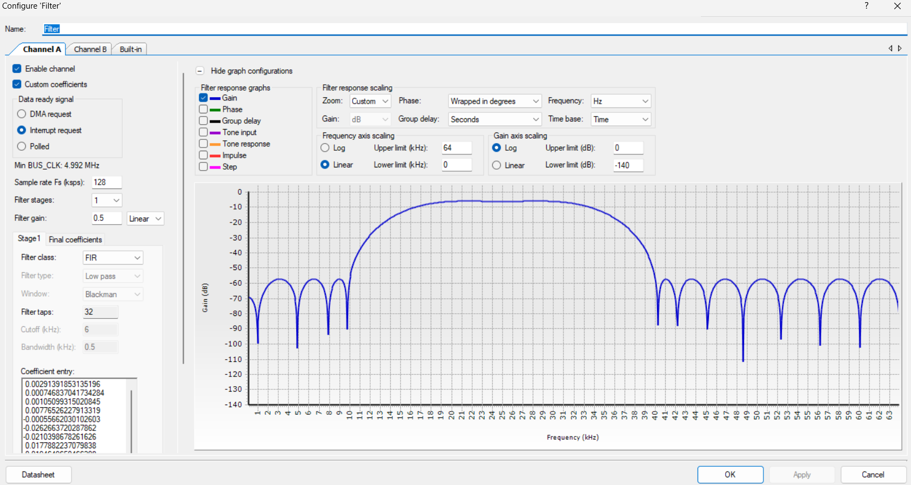
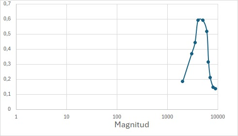
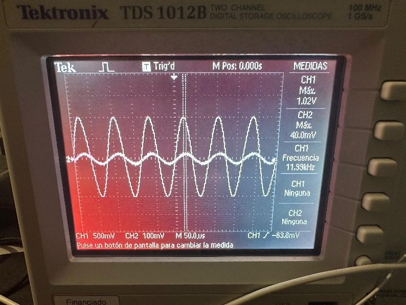

# Study: FIR vs IIR band-pass on the PSoC 5LP Filter block

**Objective.** Compare two band-pass filters running in the PSoC 5LP hardware Filter block (DFB) in real time: a 6th-order Chebyshev type I IIR and a Parks-McClellan FIR, both fed from the delta-sigma ADC through DMA and reconstructed with a VDAC.

**Method.**
- IIR: Chebyshev I, order 6, centre 5 kHz, bandwidth 2 kHz, 1 dB passband ripple, implemented as 6 biquad sections (`tf2sos`).
- FIR: Parks-McClellan band-pass, passband edges 4 and 6 kHz, stopband edges 2 and 8 kHz, Rp = 0.15 dB, Rs = 55 dB; 32 coefficients in the report. Sampling rate 44.1 kHz.
- Architecture: ADC (delta-sigma) -> DMA -> Filter block -> DMA -> VDAC, with an analog band-pass input stage (anti-aliasing and DC decoupling). The PSoC projects start from the vendor Filter/ADC/VDAC example (see below).
- Frequency response measured point by point with a function generator and oscilloscope and compared to MATLAB.

**Result.** The Chebyshev filter shows a measured magnitude peak in the 4-5 kHz region consistent with the design; the FIR was probed at 12, 20 and 35 kHz on the oscilloscope. See figures.

| | |
|---|---|
|  |  |
| Digital architecture | Chebyshev design, magnitude and phase |
|  |  |
| Filter block configured as IIR | Filter block configured as FIR |
|  |  |
| Chebyshev measured magnitude | FIR on the scope at 12 kHz (also `scope-20khz.jpg`, `scope-35khz.jpg`) |

**Contents.** `matlab/` design script; `psoc/cheby`, `psoc/pmfir` PSoC Creator project files (`.cyprj`, `.cydwr`, `dfb.v2` coefficients, `main.c`).

**Third-party base.** `main.c` derives from Cypress' *Filter_ADC_VDAC* example code (copyright Cypress Semiconductor). The vendor example and its documentation are not redistributed here; see the "PSoC 5LP 16 Bit and 24 Bit Digital Filter Code Examples" application note on the Infineon/Cypress site.

**Authors.** Elías David Álvarez Martínez and Tania Patricia Romero Centurión, May 2024; advisor: Lic. Federico Daniel Morán Fretes.
